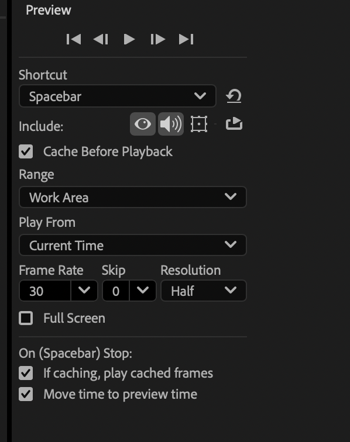

# 12 Oct

## Recap last class

* CMD + double click on the anchor point thingy on the menu left up, for put it back on the middle.
* To edit the background: press it, go to layer window, and settings.

## Edit

If computer isn't working well go to edit/purge/all caché

* CMD + Shift + D: Split a layer
* CMD + D: Duplicate layer

## Shapes (2d)

Make sure to verify if u are making a mask or adding a shape.

* Edit colors menu up.
* press it and go to contents menu to edit details.

## Preview setup

### Link layers

Drag the remolino to the layer where I wanna link my element

Null object: layer/new/null object

> Effect/choose an effect

### Adjustment layer

Bring it to top, whatever we apply on it, will be apply to everything underneath.

### Masks 

Select your element and go to shapes.

Draw the shape (mask) and edit on mask settings.

* path
* feather (blur)
* opacity
* Expansion (reveal)

  

